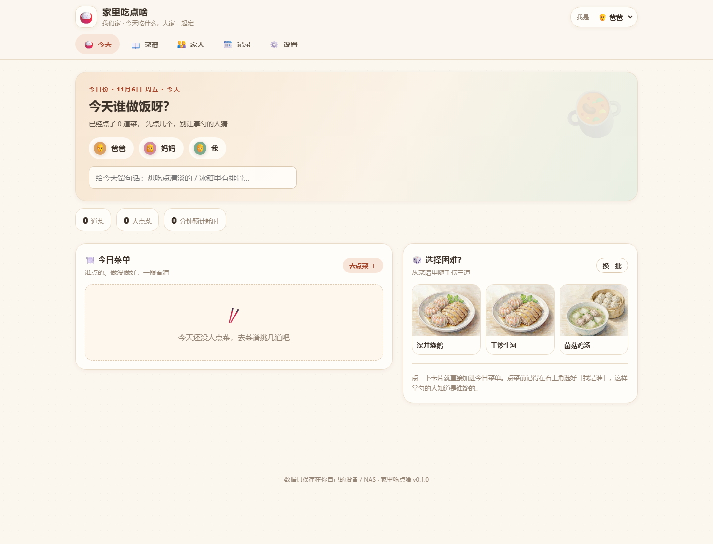
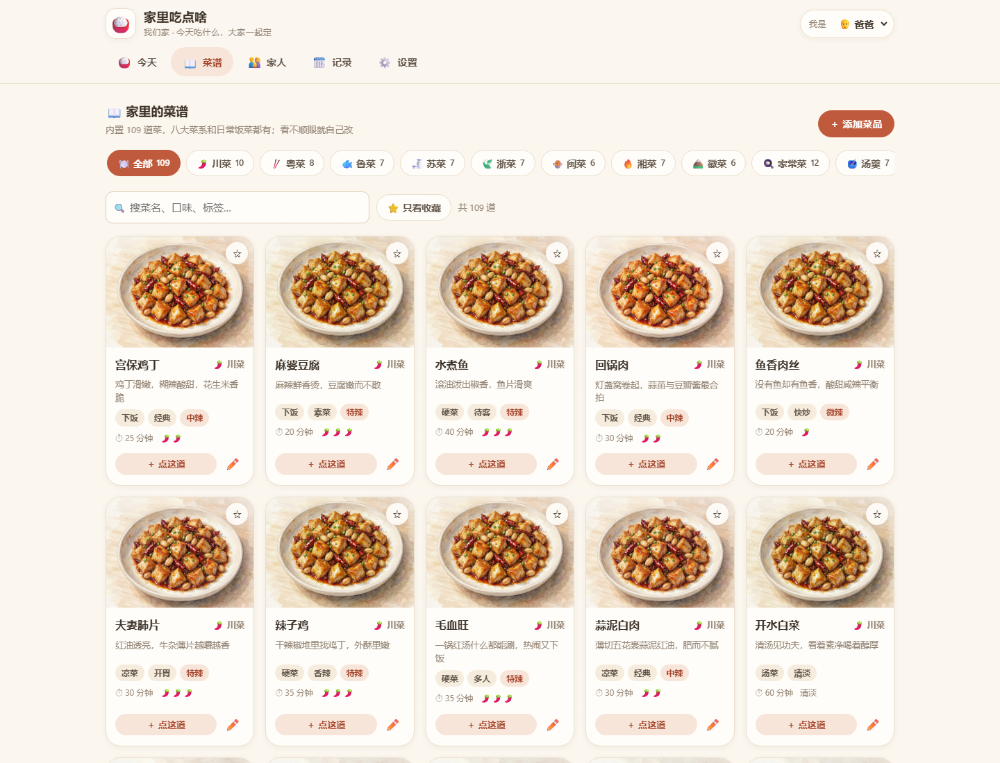
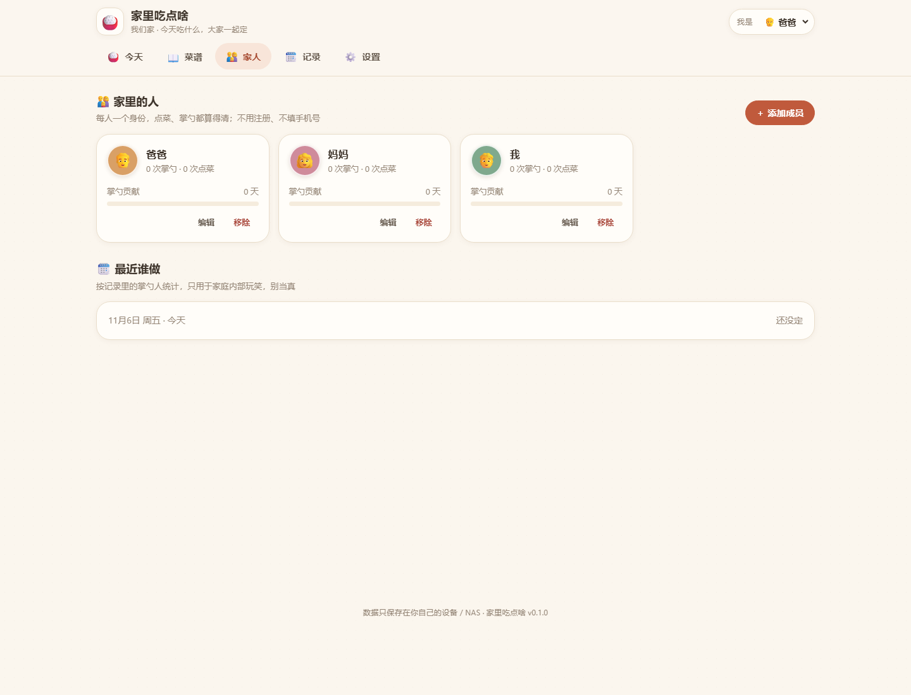
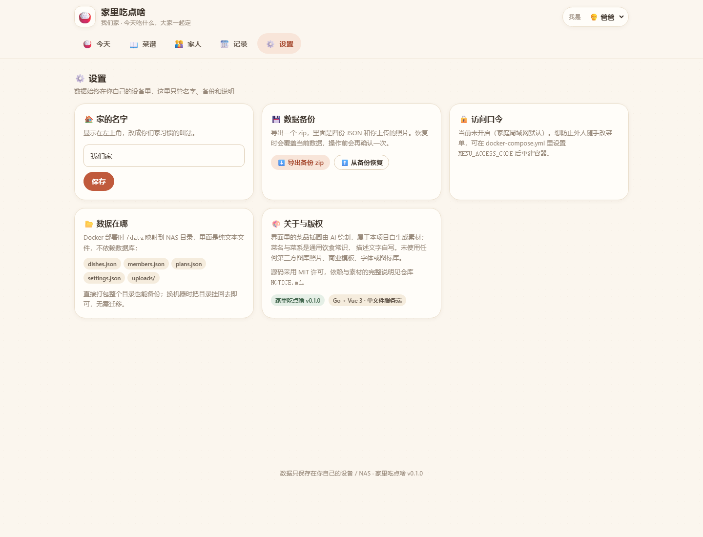

# 家里吃点啥 · 家庭点菜系统

> **中文名：家里吃点啥** ｜ 仓库：https://github.com/1316195118/Home-Feast

「今天吃什么？」——把这个问题交给全家人一起点。这是一个**完全自托管**的家庭点菜网页：手机、平板、电脑打开同一个地址，每个人选好「我是谁」，就能点菜、看做法、定谁掌勺谁洗碗。
**数据只存在自己的 NAS / 本机**，纯 JSON 文件，无数据库、无外部服务、无需注册、不上传任何数据。

## ✨ 为什么用它（优点速览）

| 优点 | 说明 |
| --- | --- |
| **零依赖单二进制** | 后端只用 Go 标准库；Docker 多阶段构建后，运行镜像里只有一个可执行文件，没有 Node.js、没有数据库 |
| **数据完全归你** | 5 个 JSON 文件存在 `/data`，直接打包就是完整备份；不依赖任何云服务，断网照常用 |
| **一条命令部署** | 仓库根自带 `docker-compose.yml`，复制下面的命令即可起；升级 `git pull` 后重建，菜单和记录都不丢 |
| **手机 / 电脑自适应** | 电脑顶栏多列、手机底部导航双列菜谱，弹窗在手机上自动变成底部抽屉 |
| **16 个菜系 + 逐道写实菜图** | 每个菜系一张写真实拍封面，157 道菜各有自己的写实图；统一 4:3 构图、盘子居中、四周等距留边、桌面色调一致 |
| **今天谁做，不用吵** | 骰子 PK 每人摇一次，点数落库、换人刷新都不丢，都摇完自动定掌勺/洗碗，平局自动加摇 |
| **音效零素材、版权干净** | 摇骰 / 胜利 / 失败全部用 Web Audio 实时合成，不带任何音频文件；图标是 emoji，字体走系统字体栈 |
| **照顾家里每个人** | 自定义用餐时段与图标、56 个分组头像、逐道菜的做法教程、网页直接改访问口令、支持系统「减少动效」 |

技术栈：**Go（标准库，运行时零依赖）+ Vue 3 + Vite**，前端构建后 embed 进单文件服务端。

---

## 一、现在能做什么

| 功能 | 说明 |
| --- | --- |
| 内置菜谱 | 100+ 道常见菜，覆盖川、粤、鲁、苏、浙、闽、湘、徽八大菜系，以及家常菜、汤羹、主食、凉菜、早餐、甜品饮品、西餐烘焙 |
| AI 效果图 | 16 个菜系各一张**写真实拍封面**（含川渝菜、新疆菜），157 道菜逐道写实图；全部经归一化处理，菜谱卡片与详情页按 4:3 完整显示，不裁盘子、无留白 |
| 家庭成员 | 每人一个昵称 + emoji 头像 + 颜色，切换身份即可点菜；不用注册、不填手机号 |
| 今天谁做 | 每天指定掌勺人、写一句备注，点菜墙按人展示，可标记「已上桌」或撤掉 |
| 选择困难 | 从菜谱随机捞三道，点一下直接加进今日菜单 |
| 自己加菜 | 增删改菜品、选菜系、写描述标签、定辣度与耗时、收藏 |
| 记录与统计 | 按天回看历史菜单、掌勺次数、本月点菜数；删菜后历史仍保留菜名快照 |
| 备份 | 一键导出 zip（4 份 JSON + 上传的照片），可从 zip 恢复；直接打包数据目录也行 |
| 可选口令 | 可在网页「设置」里直接改，也可用 `MENU_ACCESS_CODE` 环境变量锁定，防止局域网内外人改菜单 |
| 菜品与分类 | 重庆菜已并入「川渝菜」，导入菜按常识重新归类；新增新疆菜 18 道与川渝特色小吃 12 道，每道都写了自己的配料与 6 步做法 |
| 骰子 PK 定分工 | 每人摇一次，点数落库（换人、刷新都不丢）；都摇完自动定掌勺与洗碗，平局自动加摇；结果动画按人只播一次；音效由 Web Audio 实时合成，**不含任何外部音频文件** |
| 自定义用餐时段 | 每餐的名字、图标（预设面板点选，也可自定义）、收起时间都能改，过饭点自动从今日菜单收起 |
| 头像与动效 | 56 个分组头像（人物 / 动物 / 食物 / 兴趣）；统一的动效令牌与即时反馈，并支持系统「减少动效」偏好 |
| 点击指向与音效 | 按钮点击有涟漪 + 从落点扩散的「指向环」+ 目标短暂高亮 + 轻点击音；点菜 / 收藏 / 保存 / 删除各有对应合成音，失败提示配抖动动画，全部可在骰子 PK 弹窗里一键静音 |
| 深色主题 | 设置页切「跟随系统 / 浅色 / 深色」，偏好只存本机，跟随系统时随设备自动切换 |
| PWA 离线可用 | 可安装到手机 / 电脑桌面，断网仍能打开应用；数据接口不缓存，联网时永远读最新 |
| Excel 导出 | 一键下载真正的 `.xlsx`（今日菜单 + 菜谱清单两个工作表），零依赖生成，Excel / WPS 直接打开 |
| 家庭口味避雷 | 给每位家人标记忌口（预设 + 自定义），菜谱卡片会提示「⚠️ 辣」这类冲突 |
| 购物清单 | 自动归并今天已点菜品的配料，按「🥬 食材 / 🧂 佐料」两类分开，同名合并、可勾选、一键复制；还能生成一张暖米纸风格的清单图，直接保存到手机相册或发给买菜的人 |
| 不重复点菜 | 同一道菜当天已在菜单里时，再点只提示不新增；连点、多端并发也不会堆出重复行 |
| 下厨小贴士 | 详情页按辣度、耗时与主料给出可操作的火候与腌制备料建议；手机端配料表为两列小卡片 |

界面为响应式：电脑上是顶栏 + 多列，手机上自动变成底部导航 + 双列菜谱。

---

## 界面预览

**今天** — 定谁掌勺、点菜墙、随手推荐三道



**菜谱** — 16 个菜系、150+ 道内置菜，插画由 AI 绘制



**家人与设置**





---

## 二、Docker 部署到 NAS（推荐）

### 30 秒部署：复制这一条命令

在 NAS / 服务器 / 自己的电脑上（装好 Docker 与 Compose v2）粘贴执行：

```bash
git clone https://github.com/1316195118/Home-Feast.git && cd Home-Feast && docker compose up -d --build
```

浏览器打开 `http://<这台机器的 IP>:8090` 就能开始点菜。**不用装 Go、不用装 Node、不用建数据库**，`docker-compose.yml` 已在仓库根，Dockerfile 会在构建阶段自动编译前端和后端；首次约 2 分钟。

数据全部落在项目下的 `./data`（已加入 `.gitignore`，不会进仓库）。以后升级：

```bash
git pull && docker compose up -d --build
```

`data/` 不动，菜单、成员、历史、上传的照片都在。

### 完整 compose（可直接复制保存）

下面就是仓库根 `docker-compose.yml` 的**完整内容**。改端口、改挂载路径、加访问口令，编辑这个文件即可。
注意 `build: .` 需要同目录里有 `Dockerfile` 和源码，所以请把它放在 clone 下来的项目根目录里（或直接改 clone 下来的那份）：

```yaml
name: family-menu

services:
  family-menu:
    build: .
    image: family-menu:local
    container_name: family-menu
    # 群晖 / 绿联等 NAS 若需要指定运行身份，取消下一行注释并按实际 UID:GID 调整：
    # user: "1000:10"
    ports:
      - "8090:8090"          # 宿主机:容器，改左边即可换端口
    environment:
      - TZ=Asia/Shanghai
      # 可选：设置后网页需要输入访问口令，防止局域网内外人改菜单
      # - MENU_ACCESS_CODE=please-change-me
    volumes:
      - ./data:/data          # NAS 上改成 /volume1/docker/family-menu/data:/data
    restart: unless-stopped
    healthcheck:
      test: ["CMD", "wget", "-qO-", "http://127.0.0.1:8090/api/ping"]
      interval: 30s
      timeout: 5s
      retries: 3
      start_period: 10s
    deploy:
      resources:
        limits:
          cpus: "1.0"
          memory: 256M
```

改完在同一目录执行 `docker compose up -d --build` 即可，其它什么都不用配。

### 拷到 NAS 上跑

把**整个项目目录**拷到 NAS，例如 `/volume1/docker/family-menu/`，然后：

```bash
cd /volume1/docker/family-menu
docker compose up -d --build
```

浏览器打开 `http://<NAS 的 IP>:8090`。

`docker-compose.yml` 里按你的 NAS 调整两处：

```yaml
    volumes:
      - /volume1/docker/family-menu/data:/data   # 群晖 DSM 示例
    # user: "1000:10"                            # 绿联 UGOS Pro 首用户；群晖可省略
```

| NAS / 系统 | volumes 左侧写法 | 备注 |
| --- | --- | --- |
| 群晖 DSM | `/volume1/docker/family-menu/data:/data` | 一般不用设 `user` |
| 绿联 UGOS Pro | `/volume1/docker/family-menu/data:/data` | 建议 `user: "1000:10"` |
| 极空间 / 铁威马 / 普通 Linux | `./data:/data` | 相对路径最简单 |
| Windows + Docker Desktop | `./data:/data` | 也可直接跑 `menu.exe` |

升级不会丢数据：容器内 `/data` 是唯一持久化目录。

端口冲突就改 `ports` 左边，例如 `"8091:8090"`。想加访问口令，取消 `MENU_ACCESS_CODE` 注释并改成自己的值，再 `docker compose up -d --build`。

也可以手动构建镜像：

```bash
docker build -t family-menu:local .
docker run -d --name family-menu -p 8090:8090 \
  -v /volume1/docker/family-menu/data:/data \
  -e TZ=Asia/Shanghai --restart unless-stopped family-menu:local
```

### 已部署实例：PVE 里的 Docker LXC（2026-11-06）

| 项 | 值 |
| --- | --- |
| 访问地址 | **http://10.10.10.251:8090** |
| PVE 宿主机 | `10.10.10.252`，PVE 9.2.24 |
| 容器 | CT 100 `docker-LXC`，Debian 13，Docker 29.9.2 / Compose v5.7.0 |
| 项目目录 | `/opt/family-menu/` |
| 数据目录 | `/opt/family-menu/data` → 容器内 `/data` |
| 源码备份包 | `/opt/family-menu-src.tgz` |
| 镜像 / 容器名 | `family-menu:local` / `family-menu`，端口 `8090:8090` |
| 访问口令 | 未启用（家庭局域网） |

该 LXC 已配置 Docker Hub 镜像加速；`Dockerfile` 里固定用 `registry.npmmirror.com` 装前端依赖，规避国内网络抖动。首次 `up -d --build` 约 2 分钟。

常用运维（在 CT 100 内执行，或由 PVE 宿主机 `pct exec 100 -- <命令>`）：

```bash
cd /opt/family-menu
docker compose ps                     # 状态与健康检查
docker compose logs -f family-menu    # 看日志
docker compose restart               # 重启
docker compose up -d --build          # 更新源码后重建
docker compose down                   # 回滚/停机，data 目录保留
cp -a /opt/family-menu/data /opt/family-menu-data-backup-$(date +%F)   # 备份数据
```

回滚：先备份 `data/`，`docker compose down` 后如需恢复源码可重新解开 `/opt/family-menu-src.tgz`。部署过程未改动 PVE 宿主机配置、CT 配置或同机其它容器。

---

## 三、不用 Docker，直接跑单文件

```bash
# Windows
build.bat                 # 生成 menu.exe
menu.exe -port 8090 -data .\data

# Linux / macOS / WSL
./build.sh                # 生成 ./menu
./menu -port 8090 -data ./data
```

构建需要 Node 20+ 与 Go 1.24+；**运行只需要那一个可执行文件**。打开 `http://127.0.0.1:8090`。

| 参数 | 默认值 | 说明 |
| --- | --- | --- |
| `-addr` | `0.0.0.0` | 监听地址，只给本机用可设 `127.0.0.1` |
| `-port` | `8090` | 监听端口 |
| `-data` | 程序旁 `data/` | 数据目录，NAS 上指向挂载卷 |
| `-version` | — | 打印版本号 |

等价环境变量：`MENU_ADDR`、`MENU_PORT`、`MENU_DATA_DIR`、`MENU_ACCESS_CODE`。命令行显式传入的参数优先级更高。

---

## 四、目录结构

与 [gift-book](https://github.com/1316195118/gift-book) 保持同类的组织方式（**仅结构参考，代码完全自写，详见 [NOTICE.md](NOTICE.md)**）：

```
cmd/menu/            Go 入口：参数、嵌入资源、优雅退出
internal/api/        HTTP 接口、静态资源、上传、备份
internal/store/      数据模型 + JSON 文件存储（原子写、并发锁）
internal/seed/       首次启动的内置菜品与示例成员
web/                 Vue 3 + Vite 前端源码
web/src/styles/      四层 CSS：设计令牌 / 基础 / 组件 / 版面
web/public/dishes/   16 个菜系的水彩插画 + 内置菜品图（压缩后的 JPEG）
webapp/dist/         前端构建产物，Go embed 目录（构建时生成）
docs/artwork/        AI 插画原始 PNG（含生成平台标识，留档）
scripts/             构建、接口测试、图片转码
data/                运行期数据（已 gitignore）
```

---

## 五、数据长什么样

```
data/
├── dishes.json      菜品库（内置 + 自定义）
├── members.json     家庭成员
├── plans.json       每日安排：掌勺人、备注、点菜记录
├── settings.json    家庭名等设置
└── uploads/         自己上传的菜品照片
```

- 每次写入走「写临时文件 → fsync → 原子改名」，断电最多回到上一份完整文件。
- 点菜记录里冗余保存了菜名与点菜人昵称，删掉菜品或成员后历史依然读得懂。
- 备份：页面「设置 → 导出备份」，或直接 `tar czf menu-backup-$(date +%F).tgz data/`。

---

## 六、开发与验证

```bash
cd web && npm install && npm run dev     # 前端热更新，代理到本机 8090
node scripts/build.mjs                  # 前端 + Go 一步构建
BASE=http://127.0.0.1:8090 node scripts/api-test.mjs   # 接口冒烟测试
go vet ./... && go test ./...           # 后端静态检查
go run scripts/optimize-images.go       # 把 docs/artwork 的 PNG 重新转成 JPEG
```

`api-test.mjs` 会临时建一道测试菜、点一次菜再清理，并还原当天的掌勺人与备注。
开启了访问口令时用 `CODE=你的口令 node scripts/api-test.mjs`。

---

## 七、版权与素材

用户特别关心这一点，这里说清楚：

- **全部源码、CSS、文案独立编写**，MIT 许可。只参考了 gift-book 的「目录怎么分、构建怎么串」，**没有复制它的任何代码、样式、文案、图标或图片**。
- 运行时零第三方 Go 依赖；构建期依赖 Vue 3 / Vite / @vitejs/plugin-vue（均 MIT），Go 标准库（BSD-3-Clause）。未引入 GPL/AGPL 代码、商业模板、UI 组件库。
- 菜名与菜系属于通用饮食常识；描述、标签、耗时为自行撰写，**未摘录任何菜谱网站或图书**。
- 菜品插画由 AI 生成，属本项目自生成素材；原始图留档在 `docs/artwork/`，未使用任何图库照片。图标为 emoji 与自写 SVG/CSS，字体走系统字体栈，不分发第三方字体/图标文件。

完整清单见 [NOTICE.md](NOTICE.md)，许可证见 [LICENSE](LICENSE)。

---

## 八、后续可以继续优化的方向

第一版刻意保持轻量，下面是自然延伸点：接入菜品做法/配料与购物清单、每周掌勺排班与轮换提醒、家庭口味避雷标签、多人实时同步（SSE）、PWA 离线可用、按季节/冰箱食材智能推荐、Excel 导出、深色主题、多家庭/多账簿隔离、自动化定时备份到 NAS 另一目录。

---

MIT © 2026 Family Menu contributors
